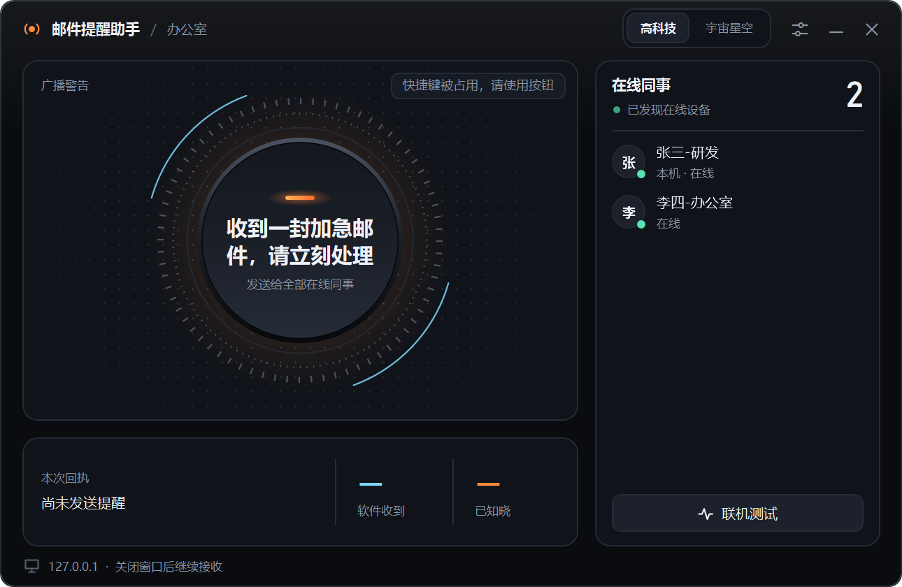
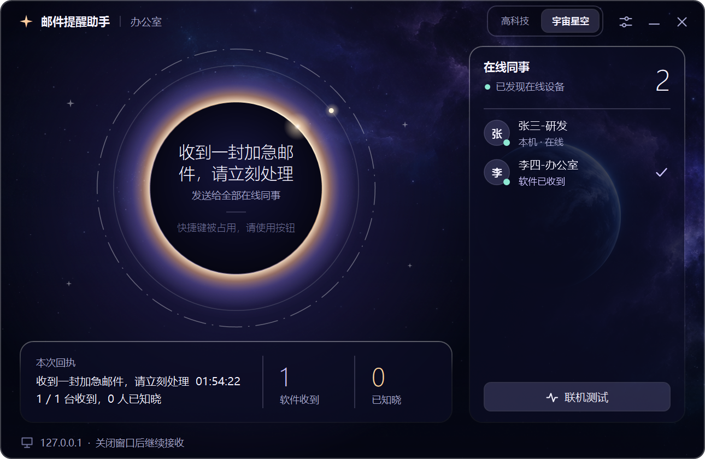

# 邮件提醒助手

面向办公室小团队的跨设备提醒工具。点击桌面按钮、双击悬浮球或使用快捷键，即可向同组在线设备发送“收到一封加急邮件，请立刻处理”。

Windows 桌面端通过局域网广播发现同事，手机通过八位绑定码加入对应团队和网段。软件收到与用户主动点击“知道了”的回执分别统计。

## 功能

- Windows 托盘常驻、全局快捷键、可拖动悬浮球与右侧贴边半隐藏。
- 高科技和宇宙星空两套主题，配套主面板、弹窗、悬浮球与动态效果。
- 在线同事列表包含本机，中文名称修改后即时同步。
- 提醒展示约五秒，人工知晓回执由点击“知道了”触发。
- 安卓与桌面双向提醒，绑定码一次有效，支持中文改名及换绑。
- 安卓接收与回执使用独立工作线程，支持网络变化重连、通知权限和频道状态提示。
- Windows 与安卓内置在线更新检查，下载后进行文件校验。
- Node.js 中转服务支持团队与网段隔离、长轮询、消息去重和持久化手机绑定。

## 当前版本与使用范围

| 组件 | 版本 | 环境与范围 |
| --- | --- | --- |
| Windows 桌面端 | 1.3.0 | Windows 10，.NET Framework 4.7.2 或更新版本 |
| 安卓客户端 | 1.3.1 | Android 8.0 或更新版本，持续后台连接需要设备允许通知与后台运行 |
| iOS 客户端 | 1.3.0 | iOS 16 或更新版本，当前在应用前台、屏幕解锁时接收 |
| 中转服务 | 1.3.0 | Node.js 22 或更新版本，移动端通过 HTTPS 连接 |

**iOS 的后台和锁屏推送尚待 APNs 接入。** 云构建生成未签名 IPA，可在 Windows 上使用自己的 Apple 账户签名安装。安装过程和个人签名刷新见 [iOS 安装教程](ios/安装与使用教程.txt)。

## 桌面界面

高科技主题



宇宙星空主题



截图中的名称与网络地址来自本机测试环境。

## 构建 Windows 版本

准备 PowerShell 7、.NET SDK 和 .NET Framework 4.7.2 Developer Pack。开发者包提供编译 WPF 所需的引用程序集。

在仓库根目录执行以下命令。

```powershell
pwsh -File ./build.ps1
```

脚本在首次构建时生成本地 `team.json` 和随机团队密钥，输出到 `release/MailReminder-1.3.0/`。同一团队分发同一份配置，双击输出目录中的“邮件提醒助手.exe”运行。

默认局域网广播地址为 `192.168.20.255`，UDP 端口为 `45820`。在自己的网络中使用时，按网段调整 `team.json`。字段示例见 [team.example.json](team.example.json)，示例密钥字段需要替换为实际生成的值。

运行完整桌面回归还需要 Node.js 22，可执行以下命令。窗口回归会在当前桌面创建测试窗口。

```powershell
pwsh -File ./build.ps1 -Test
```

## 构建安卓版本

准备 Python 3.10 或更新版本、JDK 21、Android SDK Platform 35 与 Build Tools 35.0.0。设置 `ANDROID_SDK_ROOT` 或 `ANDROID_HOME`，并设置 `JAVA_HOME` 或将 JDK 的 `bin` 加入 `PATH`。

```powershell
$env:ANDROID_SDK_ROOT = 'C:\Android\Sdk'
$env:JAVA_HOME = 'C:\Program Files\Java\jdk-21'
python ./android/build.py
```

输出为 `release/mail-reminder-android-1.3.1.apk`。首次构建会在本地 `android/.signing/` 生成项目签名，后续版本继续使用该目录中的签名资料。自己构建的应用使用自己的签名，覆盖安装需要签名一致。

绑定、通知和升级说明见 [安卓使用说明](android/使用说明-1.3.1.txt)。

## 构建 iOS 版本

在 Mac 上准备 Xcode 与 XcodeGen，然后执行以下命令。

```bash
bash ios/build_ipa.sh
```

也可在 GitHub 的 Actions 页面手动运行 **Build iOS IPA**。工作流使用标准 `macos-15` runner，包含模型检查、iPhoneOS arm64 包构建和模拟器首次启动检查。构建产物保留一天，请及时保存到本机。

IPA 输出在 `ios/output/`。Windows 用户可按 [安装与使用教程](ios/安装与使用教程.txt) 使用 Sideloadly 签名安装，然后在桌面托盘的“手机绑定”窗口生成八位绑定码。

## 中转服务与自部署

局域网桌面通信使用团队配置中的广播地址与密钥。手机同步还需要部署 HTTPS 中转服务，并让客户端连接同一服务入口。

当前客户端源码内置 FEIAN 服务地址。自部署时需要配置桌面端的 `team.json`，并替换安卓、iOS 的服务地址及对应同源校验。具体位置和服务启动步骤见 [部署说明](docs/部署中转服务.md)，接口字段见 [协议说明](server/PROTOCOL.md)。

在仓库根目录执行服务端回归。

```bash
node --test server/tests/relay.test.mjs
```

`server/mail-reminder.service` 提供 Linux systemd 服务示例。在线更新接口可通过 `RELEASES_DIR` 指定的应用文件生成版本信息。

## 验证范围

已完成桌面本机回归、安卓主机并发检查、服务端回归，以及 iOS 编译和模拟器首次启动检查。真实办公室跨电脑、安卓锁屏后台、iPhone 签名安装与业务收发仍需在目标设备上确认。状态与测量范围见 [验证说明](docs/验证范围.md)。

延迟诊断工具位于 `tools/latency-ack-fault.mjs`，可在本机复现慢回执对串行收取的影响。

## 目录

| 路径 | 内容 |
| --- | --- |
| `src/`、`ui/`、`assets/` | Windows 程序、主题资源与星空素材 |
| `android/` | 安卓源码、构建脚本与主机检查 |
| `ios/` | SwiftUI 源码、XcodeGen 工程描述与 IPA 构建脚本 |
| `server/` | Node.js 中转服务、接口说明及回归 |
| `tests/` | Windows 通信、更新与窗口回归 |
| `docs/` | 界面截图、部署与验证说明 |

## 开源许可

采用 [MIT License](LICENSE)，允许按许可证条款使用、修改与分发。
